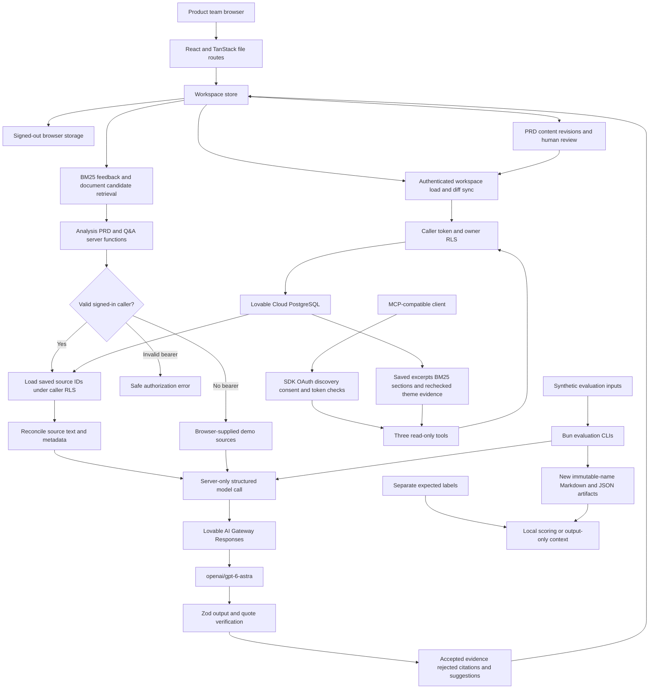

# Actual technical architecture

Local source audit finalized 2026-11-06. This describes inspected implementation, not newly verified hosted configuration. No code, integrations, auth settings, secrets or model calls changed. Verification boundaries are in [FINAL_PROJECT_AUDIT.md](FINAL_PROJECT_AUDIT.md).

## Components and technology

| Layer | Actual implementation | Source |
|---|---|---|
| Web UI | React 19, TypeScript, TanStack Start 1.168.60 / Router 1.170.41 (manifest), file routes, Tailwind 4, existing UI components | `src/router.tsx`, `src/routes/`, `src/styles.css`, `package.json` |
| Development/build | Vite 8.1.5; Lovable TanStack configuration and MCP Vite plugin | `vite.config.ts` |
| Internal server APIs | TanStack `createServerFn`; SSR/server execution on managed Worker runtime | `src/start.ts`, `src/server.ts`, `src/lib/voc/*.functions.ts` |
| State | One workspace provider; browser storage when signed out; owner-scoped cloud row diffs when signed in | `store.tsx`, `persist-map.ts`, `persist.functions.ts` under `src/lib/voc/` |
| Auth/database | Lovable Cloud managed auth and PostgreSQL, generated browser/server clients, SQL RLS | `src/integrations/`, `drizzle/migrations/` |
| LLM | Vercel AI SDK (`ai`, `@ai-sdk/openai`), streamed Responses through Lovable AI Gateway; `openai/gpt-6-astra` | `src/lib/voc/llm.server.ts` |
| Retrieval | Custom lexical BM25 and excerpt selection; PDF.js browser text extraction | `bm25.ts`, `retrieval.ts`, `docs.ts`, `pdf-extract.ts` under `src/lib/voc/` |
| MCP | `@lovable.dev/mcp-js` 3.1.1 range; Streamable HTTP endpoint and OAuth | `src/lib/mcp/`, `src/routes/mcp.ts` |
| Validation/tests | Zod, Vitest, pure evaluation modules and Bun CLIs; Python historical browser-verification script | `src/lib/voc/eval/`, `scripts/`, `src/test/` |

No vector database, embeddings service, n8n, GitHub/Jira/Linear writes, ticket-provider ingestion API or scheduled analysis is implemented. Synthetic Trellis docs that mention integrations describe the **fictional product**, not integrations of this application. Current configuration is not Gemini and does not use the newer Gateway SDK.

## Architecture diagram

The diagram's model path is implemented but access was last recorded blocked. Evaluation inputs are synthetic snapshots, not live saved-account reads. Expected scenario labels never enter generator/judge calls; generic evaluation rubrics intentionally reach automated judges.

## Pages and user flow

`/` Overview → `/feedback` → `/insights` → `/prioritization` → `/prd` → `/review` or `/tasks`; `/knowledge` provides document search/Q&A; `/auth` and `/settings` supply account/configuration views. `/mcp` is a protocol endpoint, not a product page. Root mounts the workspace provider. Content routes have app-specific head metadata; no application head changes were made.

## Ingestion and retrieval

1. CSV tokenizer supports quoted cells/newlines, escaped quotes, required `text`, row errors and missing metadata. Feedback upload UI caps files at 2 MiB. Normalized-text duplicates remain flagged; collision IDs are renamed instead of overwriting; whole already-imported CSV data adds no rows.
2. Documents carry title, version, kind, filename, import time, section IDs, headings and PDF page references. Markdown splits on headings; text uses paragraph chunks; CSV uses row sections. A 1,200-character target is **not a strict maximum** for a single oversized paragraph/row.
3. PDF.js is dynamically imported in browser event handling; it extracts text from at most 200 pages. Empty extraction warns about scanned PDFs; there is no OCR or explicit >200-page warning. Document UI limit is 5 MiB.
4. Baseline theme matching uses a fixed seven-theme development catalogue. Rating-derived sentiment, keyword severity, citation-count confidence and enterprise share are heuristics, not calibrated predictions.
5. Search builds separate feedback/document BM25 indexes to avoid mixing IDF populations, preserves source type, excludes flagged duplicate feedback and returns excerpts. It merges per-type scores; these are not calibrated cross-source relevance probabilities. The source filter controls displayed search hits; Ask AI independently retrieves both source types.
6. PRD retrieval takes up to 30 theme-cited feedback records and eight document hits; Q&A typically retrieves eight feedback/eight document hits. Server schemas permit 30/12 for PRD and 12/12 for Q&A, each text ≤4,000 characters. Analysis processes ≤300 records at ≤1,500 characters each after source reconciliation. Context limits are not an unlimited corpus RAG pipeline.

## Model interaction and grounding

`analyze.functions.ts` and `generate.functions.ts` resolve optional callers with `caller.server.ts`; `source-auth.ts` replaces submitted source copies with saved caller-owned records/sections when IDs/text match. Unknown/not-owned and text mismatches are rejected individually; remaining accepted sources may still be used. A present invalid bearer is an error, never a demo fallback. No bearer permits browser-supplied demo inference; no app-level caller quota was found.

`prompt.ts` separates instructions from untrusted feedback/docs, escapes angle delimiters, forbids invented quotes/numbers/commitments, requests assumptions and capability clarifications, and instructs Q&A to disclose conflicting documents unless explicit precedence exists. These are safeguards, not proof of injection immunity. Attribute values are not fully escaped by angle-only cleaning.

`llm.server.ts` holds model calls and streaming. PRD generation uses medium reasoning; analysis/Q&A and judges default low. Structured output is Zod-validated; `maxRetries: 1` remains unchanged. Cause-chain status handling maps 402 to `credits`, 401 to configuration, 403 to denied, 429 to rate limiting, and output/network errors to safe messages. No script replay loop exists; 402 does not get a safe transient retry. `getModelStatus` reports credential presence/model name—not actual eligible access.

`grounding.ts` requires a source ID and an 8+ character contiguous quote, case-insensitive with smart-quote/delimiter normalization; returned excerpts come from the source text. PRDs with **no accepted feedback quote** downgrade evidence requirements/stories; undocumented claims lacking accepted doc quotes become unverified. One accepted quote can still leave a partly unsupported compound claim marked supported; rejected citations remain visible. Free-text scope, risks, metrics and answer prose are not fully semantically verified. No claim-level entailment guarantee exists.

## Persistence and source history

Operative SQL: `drizzle/migrations/0000_voc_workspace_schema.sql`, `0001_revoke_anon_workspace_tables.sql`, `0002_human_reviews_and_provenance.sql`. All 11 workspace tables are owner-scoped:

| Data | Tables/relationships |
|---|---|
| Feedback and imports | `feedback_records`, `import_runs`; source IDs and line references preserved |
| Documents | `product_docs` → `doc_sections`; title/version/page metadata |
| Analysis | `analysis_runs`, one latest `ai_analyses` row per owner with themes/provenance |
| PRDs | `ai_prds` → `prd_revisions` (insert-only content revisions) |
| Human judgments | `human_reviews` references exact owner/PRD/revision; optional story target |
| Draft actions/settings | `draft_tasks`, `workspace_settings` including weights/import choice |

`persist-map.ts` round-trips state and derives row diffs; server stamps owner ID and uses caller client/RLS, batches 500 upserts, loads in pages of 1,000. Sync deletes in reverse dependency order and saves in dependency order. Multi-table saves are **not transactional**; partial failure preserves onscreen state and a retry message, not a durable offline queue. Store debounces 800 ms, serializes saves, warns before leaving unsaved changes, and flushes before AI.

PRD content revisions cannot ordinarily be updated/deleted by authenticated users. However the source snapshot resides on mutable parent `ai_prds.sources`, not separately on each revision; regeneration can replace older revision context. Retain a separate frozen report/source snapshot for genuine review. Parent deletion cascades and privileged clients are separate boundaries; “immutable” does not mean tamper-proof audit storage. Simultaneous same-row edits/revision-number collisions have no optimistic concurrency check. Latest analysis staleness signature contains IDs/order, not text hashes; in-flight analysis assigns the then-current record signature on completion. These limitations prevent a universal stale-result guarantee.

## Authentication and security boundaries

- Email/password sign-in/sign-up and Google UI exist. Hosted provider/email confirmation settings and signup confirmation were **not rechecked**; automatic confirmation must remain disabled. No profiles/roles product feature is implemented.
- `src/start.ts` attaches caller bearer middleware and server-function CSRF protection. Protected persistence requires claims validation. OAuth return paths are restricted to local destinations; Google redirect behavior needs hosted flow verification, especially consent returns.
- SQL RLS uses owner ID; anonymous workspace grants are revoked. Regular server/MCP access does not use the generated privileged server client that bypasses RLS.
- Private model credential is server-only. Generated metadata/env variable names are listed in [README](../README.md); never print values. React text rendering and domain error logs are inspected safeguards, not a fresh security scan. Generic error handlers can log error objects; comprehensive sensitive-log guarantees were not established.
- MCP has strict inputs, SDK verified OAuth-client claims, caller-token database reads, bounded result budgets and 15-second **per database fetch** cancellation/deadlines—not a total request SLA. Hosted forwarded-header trust, production expiry/revocation, actual two-owner isolation and latest timeout deployment remain unverified.

## MCP and APIs

| Tool | Reads/returns | Important qualification |
|---|---|---|
| `get_feedback_evidence` | Saved feedback IDs/excerpts/metadata, query/theme filters | Direct source excerpts, not model output |
| `search_product_docs` | Saved docs/sections, shared BM25, title/version/heading/page | No embeddings; absent search hit is not proof capability unavailable |
| `get_theme` | Latest saved analysis and caller feedback; exact `includes` recheck | Rejects invalid excerpts, labels AI suggestions and related-not-cited hits; stale flag is ID-based |

`src/lib/mcp/index.ts` defines the three tools. MCP Vite plugin generates `/mcp` and discovery route; consent page is `/.lovable/oauth/consent`. The external MCP client handles discovery/registration/authorization/token exchange. Stored theme quotes use a stricter source substring check, not a call to shared `verifyCitations`. Browser `list_visible_feedback` via `use-webmcp-tool` is local and separate from OAuth tools; supporting-browser operation is unverified.

Historical owner Inspector connection/tool discovery and reported tool calls are recorded, not rerun in this audit. [Integration contracts](INTEGRATION_CONTRACTS.md) distinguishes them from proposed writes/n8n.

## Evaluation and trade-offs

Pure tests cover CSV, BM25, scoring, source reconciliation, quote validation, docs, revisions, review, MCP input/token/failure handling, and evaluation/report contracts. CLIs are evaluation-only and do not enter product routes. Frozen run files, prompts/data/dependency hashes, separate labels and generic judges preserve methodological transparency; same-system synthetic authoring/judging is not independent validation. [Results](EVALUATION_RESULTS.md) is the historical metric authority.

BM25 was retained for inspectability and the limited 90% Recall@5/10-query result, not because embeddings were proven inferior. Row-level persistence reduces different-row overwrite exposure without solving same-row concurrency. Read-only MCP limits side effects. Human approval is a future prerequisite for external writes; currently no external writer exists. Portfolio evidence must not convert implementation into validated customer outcomes.
